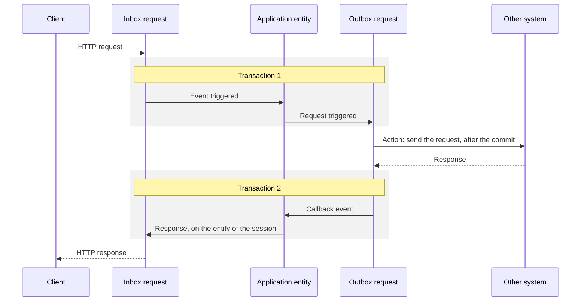

# Transitions, transactions and sessions

The state machine processes events in three units of work, each made of one or more of the one before it. A
transaction stores one or more transitions, and a session is one or more transactions.

| Unit        | What it is                                                                                                   | What it guarantees                                                          |
|-------------|--------------------------------------------------------------------------------------------------------------|-----------------------------------------------------------------------------|
| Transition  | An entity going from one state to the next on an event                                                       | It is only calculated, with no side effects                                 |
| Transaction | The transitions one event leads to through event triggers, whose new events and triggers are stored together | All of it is stored or none of it is                                        |
| Session     | The transactions one event entering the state machine leads to through actions                               | Its transactions share the session's entities and caller, but not atomicity |

## Transitions

A [transition model](transition-models.md) takes an entity of its [entity model](entities.md) from a state to the
next on an event type. Taking it calculates the new event of the entity, and the triggers it declares, from the event
log of the entity and the data of the event. Nothing is stored and nothing is sent while it is calculated.

A transition triggering an event on another entity (an event trigger) continues with the transition of that entity,
nested in its own, and that one may trigger events on yet other entities in turn. The transitions an event leads to
this way form one chain of steps, from the input step of the first transition to its output step, with the steps of
the nested transitions in between (see [Steps](transition-models.md#steps)). They are taken in one transaction.

## Transactions

When the transitions of the event are calculated, their changes are
[collected](transition-models.md#collecting-the-changes) from the chain and stored in one database transaction:

* the new events of every entity involved,
* the delayed triggers (`after(..)`), such as timeouts,
* the conditional triggers.

Either all of them are stored or none of them are. If another instance has appended an event to one of the
entities in the meantime, the transaction fails on the event number, and its transitions are calculated again from
the new event logs, up to three times (see [Processing an event](entities.md#processing-an-event)). They are also
calculated again if an id one of them claims is found to be taken (see [Existing ids](existing-ids.md)). The outcome of an action
is the exception, see [What a later transaction sees](#what-a-later-transaction-sees).

The actions of the transitions, such as sending an [outbox request](http-outbox.md), are run only after the
transaction is committed. Delayed triggers are fired by a worker when they are due, and conditional triggers when
their condition is met. What happens then is processed as a new event, in a transaction of its own.

## Sessions

A session starts with an event entering the state machine through `StateMachine.onEvent`, such as a request received
by an [HTTP inbox](http-inbox.md). It is the transaction storing what that event leads to, and the transactions of
the outcomes of its actions, such as the response to an outbox request. The outcome of an action is processed as a
new event, in a transaction of its own, on the entity whose transition ran the action. Its transaction is part of the
session, and can:

* **Find the entity of the session.** An event triggered on the entity identified by the session
  (`entityIdFromSession()`) goes to the entity of the trigger's entity model that the session last took a transition
  on before the trigger: in the transaction of the trigger first, then in the transactions before it. For an
  `EntityModelGroup`, such as `HttpInbox.Request`, it is the entity of a model in the group, and the session is the
  only way to identify it. That is how an application responds to the
  [inbox request](http-inbox.md) it was called from, e.g. from the callback of an outbox request, without knowing
  which inbox request that is.
* **Reach the caller.** `StateMachine.onEvent` returns the new events with the entity id it was called on, of any
  entity model, so also those of an id or index entity with the same id, and also events which are not stored. The
  events of later transactions of the session are returned as well, which is how the `HttpInboxListener` gets a
  response given after a request to another system.

A session gives no atomicity across its transactions. Each one is committed on its own, and a failure in a later one
doesn't undo the ones before it. That is why the entities involved record what they have started, and why an outbox
request stores a timeout in the transaction sending it (see [HTTP outboxes](http-outbox.md)).

Delayed and conditional triggers start a session of their own when they fire. They keep the correlation id of the
transaction storing them, but neither its entity nor its caller.

An inbox request whose application calls another system has one session of two transactions, each with
several transitions:

### What a later transaction sees

A transaction of the session finds the entity of the session in any transaction before it, however many actions back,
e.g. to answer the entity the session started on after one action and then another. The event log of a stored entity
it triggers an event on is read from the database again, as events of other sessions may have been stored on it in
the meantime, and with the output of [masked events](entities.md#events-and-entities-not-stored) masked. An entity
of the session only, which is never stored, is found among the events of the session's transactions.

A stored entity read again may also have been rolled back since an earlier transaction of the session, by another
session, e.g. one taking place while the session waits for the outcome of an action. A rollback is the built-in event
`Events rolled back` on the entity, with the number of the event to roll back to, whose transition takes the reverse
models of the events rolled back that have one. The events rolled back stay in the event log but are no longer effective, also those
the session stored itself, so the later transaction sees the entity in the state before them, and takes its
transitions from that state, or rejects the event if there is none. The entity of the session is still found, as it
is identified by the steps of the earlier transaction, not by its events. An entity of the session only is never
rolled back, as a rollback rolls back stored events only.

The entity whose action gave the outcome is the exception: its outcome is the next event after the one which
triggered the action, calculated from the event log the action was triggered with, as a delayed trigger is. If another
session has stored an event on the entity first, e.g. a delayed trigger firing or a rollback, the outcome is dropped,
not calculated again from the new event log, where it could be taken for the outcome of a later action of the entity
(see [Processing an event](entities.md#processing-an-event)). The transitions of the entity decide what follows, e.g.
by a timeout stored with the action. If the transaction of the outcome failed on the event number of another entity
it triggers an event on, its transitions are calculated again, which reads that entity's event log again.
